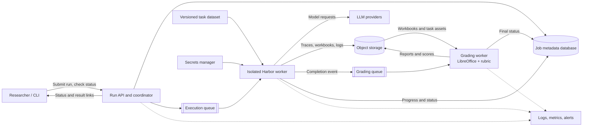

# Cloud deployment architecture

This document describes a provider-neutral target architecture for running
FinancialAuditBench in the cloud. It is a design blueprint, not deployable
infrastructure: the repository does not select a cloud provider or define
service-level, scale, or retention requirements.

## Overview

## Component responsibilities

- **Run API and coordinator:** Accept run requests, validate inputs, create job
  records, dispatch work, and expose status and authorized result links. Keep
  coordination lightweight; do not execute benchmark tasks in the API process.
- **Job metadata database:** Store job and task identifiers, selected dataset
  revision, requested model and options, timestamps, lifecycle state, worker
  attempts, and artifact references. Store metadata, not workbooks or traces.
- **Execution queue and Harbor workers:** Queue independently executable runs.
  Workers claim jobs, prepare the pinned task assets, execute Harbor in an
  isolated environment, and report progress. Bound CPU, memory, runtime,
  concurrency, and outbound network access.
- **Grading queue and grading workers:** Start grading after execution has
  completed and artifacts are available. Package LibreOffice and the rubric
  grader in the worker image. Keep grading independently scalable and retryable.
- **Versioned task dataset:** Preserve immutable dataset revisions and make the
  revision used by each run explicit, matching the current revision-pinned
  Hugging Face dataset flow.
- **Object storage:** Retain prepared task assets, workbooks, trajectories,
  logs, grading reports, and scores. Use stable job-scoped paths and lifecycle
  policies; persist outputs before acknowledging queue messages.
- **Secrets manager and model providers:** Inject provider credentials at
  runtime, scoped to the worker and provider needed. Never put credentials in
  job records, artifacts, or container images.
- **Observability:** Emit structured logs, queue and worker metrics, and alerts
  keyed by job and attempt. Avoid logging credentials or unnecessary sensitive
  workbook contents.

## Job lifecycle and reliability

1. The API validates a request and creates a job in a queued state.
2. An execution message references the job; the worker fetches the pinned
   dataset revision and credentials, then runs the selected tasks.
3. The worker uploads outputs and records artifact references and execution
   status. Successful runs requesting grading are sent to the grading queue;
   other runs become complete.
4. A grading worker downloads the required workbooks and task assets, grades
   them, uploads reports and scores, then records the final status.
5. The API returns current status and authorized artifact links to the user.

Queue delivery should be treated as at-least-once. Make state transitions and
artifact writes idempotent using job and attempt identifiers. Record failures
and retry counts; distinguish retryable infrastructure errors from invalid
requests and task failures. Support cancellation and timeouts, and ensure
retries cannot overwrite successful results from a different attempt.

## Mapping from the current project

The current CLI coordinates runs and starts Harbor as a subprocess;
`benchmark/build.py` prepares task files, and `benchmark/grading/local.py`
performs host-side grading. In the target design, these responsibilities move
behind the coordinator, execution workers, and grading workers respectively.
The existing pinned dataset revision, prepared-task manifest, Harbor job
artifacts, and local grading outputs provide useful formats to preserve during
migration.

## Suggested migration sequence

1. Define job states, request schema, artifact layout, retry/idempotency rules,
   and access-control requirements.
2. Move job and experiment metadata into a durable job store, while retaining
   the current CLI as a client.
3. Move task preparation and Harbor execution into isolated workers; store
   inputs and outputs in object storage.
4. Move local grading into separate workers with LibreOffice packaged in the
   runtime image and a grading queue.
5. Add authenticated status and artifact access, then tune worker pools and
   provider quotas from observed workload metrics.

Choose specific managed queues, databases, object storage, identity, and
observability services only after the target cloud, expected workload, data
residency, and retention requirements are known.
