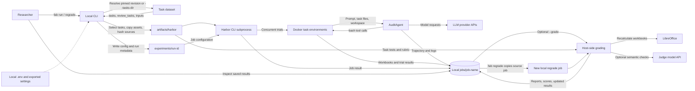
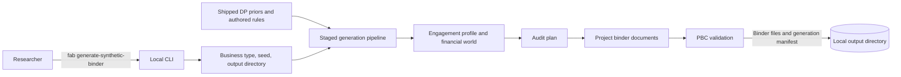

# Current project architecture

This document describes the architecture implemented by the repository today.
It complements the [cloud deployment architecture](cloud-architecture.md), which
is a proposed target rather than a description of running infrastructure.

## Benchmark execution and grading

The `fab` command runs on the user's machine. It downloads the default
revision-pinned dataset from Hugging Face or accepts a local dataset directory,
selects tasks, prepares a Harbor dataset under `artifacts/harbor`, and writes
run configuration and metadata under `experiments/`. It then invokes Harbor as
a subprocess. Harbor runs trials in Docker task environments; the benchmark's
`AuditAgent` requests model completions and executes the model's bash tool calls
through the Harbor environment. Job results, trial artifacts, and agent
trajectories are saved under the local `jobs/` directory.

Grading is optional and runs after the Harbor job completes. It is performed by
the local Python process, not inside the task containers. The grader prepares
a temporary shared workbook-recalculation cache, uses LibreOffice, evaluates
rubrics, and may call a judge model for declared semantic checks. Reports,
scores, and updated Harbor results are written into the job directory.
`fab regrade` copies a saved job to a new local job directory and grades it
against the selected task catalog and current rubrics.

## Synthetic binder generation

Binder generation is a separate local CLI workflow. It uses shipped priors and
authored rules, executes staged generation and validation, and writes a binder
package plus a generation manifest to the requested output directory. It does
not require model API calls.

## Deployment boundary

The repository currently provides a CLI and local file-based run state. Dataset
assets may come from Hugging Face; model and optional judge requests go to
provider APIs. There is no implemented run API, coordinator service, queue,
job metadata database, or shared cloud object store. See the
[cloud architecture](cloud-architecture.md) for a provider-neutral proposal
that moves execution and grading into independently managed workers.
